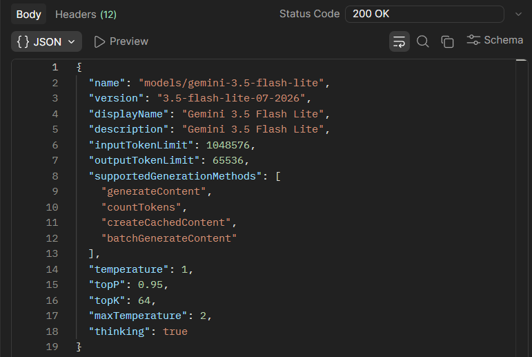
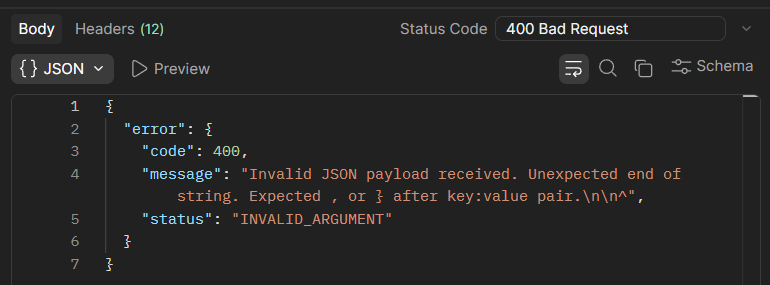

# SportSee – Préparation de l'API d'IA

## Introduction

SportSee veut proposer à ses utilisateurs un plan d'entraînement de course à pied sur 6 semaines, créé par une IA à partir de leurs séances passées et de leur objectif.

Ce document prépare cette fonctionnalité. Il présente l'API utilisée, la requête, les données envoyées et le prompt, puis les limites, les risques et les pistes pour la suite. Tous les tests ont été faits dans Postman, avec des données fictives.

L'API prévue au départ était celle de Mistral. Au moment du projet, obtenir une clé API Mistral demandait un moyen de paiement. On a donc choisi l'API Gemini de Google, qui propose une offre gratuite suffisante pour un prototype.

## 1. En bref

## 2. L'API utilisée

### Le modèle

On utilise le modèle `gemini-3.5-flash-lite`, avec l'API Gemini de Google. C'est un modèle stable, que Google présente comme son modèle 3.5 le plus rapide et le moins cher ([liste des modèles](https://ai.google.dev/gemini-api/docs/models)).



### Les limites

Un token est un morceau de texte d'environ 4 caractères. C'est l'unité qui sert à compter les limites et le prix.

| Limite                    | Valeur                                                                                                                                                     | Ce que ça veut dire                                                                                                                                        |
| ------------------------- | ---------------------------------------------------------------------------------------------------------------------------------------------------------- | ---------------------------------------------------------------------------------------------------------------------------------------------------------- |
| Taille de ce qu'on envoie | Environ 1 million de tokens                                                                                                                                | Largement assez pour les données d'un utilisateur                                                                                                          |
| Longueur de la réponse    | Environ 65 000 tokens                                                                                                                                      | Assez pour un plan de 6 semaines                                                                                                                           |
| Requêtes par minute       | 15                                                                                                                                                         | Au-delà, l'API renvoie l'erreur 429 `RESOURCE_EXHAUSTED` (ressources épuisées)                                                                             |
| Requêtes par jour         | 500, remises à zéro à minuit, heure du Pacifique (9 h en France la plupart de l'année)                                                                     | Au-delà, l'API renvoie l'erreur 429 `RESOURCE_EXHAUSTED` (ressources épuisées)                                                                             |
| Coût                      | Gratuit avec l'offre gratuite. Avec l'offre payante : 0,30 dollar par million de tokens envoyés et 2,50 dollars par million de tokens reçus                | Un plan (environ 900 tokens envoyés et 900 reçus) coûterait environ 0,25 centime de dollar                                                                 |
| Disponibilité             | L'IA est souvent surchargée : erreur 503 `UNAVAILABLE` (indisponible)                                                                                      | Il faut parfois attendre plus d'une minute avant de réessayer                                                                                              |
| Confidentialité           | Avec l'offre gratuite, Google peut utiliser ce qu'on lui envoie pour améliorer ses produits, sauf en Europe, où les règles de l'offre payante s'appliquent | Google demande de ne jamais envoyer d'informations sensibles, confidentielles ou personnelles avec l'offre gratuite : on n'envoie que des données fictives |

Sources : [quotas](https://ai.google.dev/gemini-api/docs/rate-limits), [prix](https://ai.google.dev/gemini-api/docs/pricing), [conditions d'utilisation](https://ai.google.dev/gemini-api/terms).

### Les conditions d'utilisation

Les conditions de Google posent trois règles importantes pour SportSee :

- pour proposer la fonctionnalité au public en Europe, l'offre payante est obligatoire ;
- l'API ne doit pas servir à donner des avis médicaux ;
- l'API ne doit pas être utilisée dans une application destinée aux moins de 18 ans, ou que des mineurs peuvent utiliser.

### La clé API

La clé est rangée dans l'environnement Postman « Gemini », dans la variable `apiKey`. Elle reste sur l'ordinateur : elle n'est jamais partagée ni exportée.


Elle est envoyée automatiquement avec chaque requête, dans le header `x-goog-api-key`. Ce réglage est fait une seule fois, sur la collection.


## 3. La requête

### L'adresse

| Élément | Valeur                                                                                          |
| ------- | ----------------------------------------------------------------------------------------------- |
| Méthode | `POST`                                                                                          |
| URL     | `https://generativelanguage.googleapis.com/v1beta/models/gemini-3.5-flash-lite:generateContent` |

Dans Postman, le début de l'adresse est rangé dans la variable `baseUrl` de l'environnement.

### Les headers

| Header           | Valeur             | Rôle                                                        |
| ---------------- | ------------------ | ----------------------------------------------------------- |
| `x-goog-api-key` | La clé API         | Identifie le projet (voir la partie 2)                      |
| `Content-Type`   | `application/json` | Indique que le body est du JSON. Postman l'ajoute tout seul |

### Le body

Le body contient trois parties :

- `system_instruction` : les consignes données à l'IA, identiques pour tous les utilisateurs (voir la partie 5) ;
- `contents` : les données de l'utilisateur (voir la partie 4) ;
- `generationConfig` : la forme attendue de la réponse, décrite par un schéma (voir la partie 5).

```json
{
  "system_instruction": { "parts": [{ "text": "Les consignes" }] },
  "contents": [
    { "parts": [{ "text": "Les données de l'utilisateur, en JSON" }] }
  ],
  "generationConfig": {
    "responseFormat": {
      "text": { "mimeType": "APPLICATION_JSON", "schema": {} }
    }
  }
}
```


### La réponse

Les informations utiles de la réponse :

- `candidates[0].content.parts[0].text` : le plan. C'est du JSON écrit sous forme de texte : l'application doit le convertir (avec `JSON.parse`) pour s'en servir. Dans nos tests, le plan est toujours arrivé en un seul morceau, mais l'API peut découper un texte en plusieurs morceaux (`parts`), qu'il faut alors mettre bout à bout.
- `finishReason` : `STOP` veut dire que la réponse est complète. `MAX_TOKENS` veut dire qu'elle a été coupée : le JSON serait alors incomplet et inutilisable.
- `usageMetadata` : le nombre de tokens envoyés (`promptTokenCount`) et reçus (`candidatesTokenCount`). C'est ce qui sert à calculer le coût.
- `thoughtSignature` : une version chiffrée, donc illisible, de la réflexion du modèle. Elle sert seulement dans une conversation en plusieurs échanges, pour que l'IA garde le fil. Notre requête ne fait qu'un échange : l'application peut l'ignorer.


### Les erreurs

| Erreur                                         | Cause                                                                      | Que faire                                                        |
| ---------------------------------------------- | -------------------------------------------------------------------------- | ---------------------------------------------------------------- |
| 400 `INVALID_ARGUMENT` (argument invalide)     | Clé invalide, ou body mal écrit                                            | Corriger la clé ou le body. Inutile de réessayer                 |
| 403 `PERMISSION_DENIED` (permission refusée)   | Le projet n'a pas accès à l'API (vérification, facturation, clé divulguée) | Régler le compte ou créer une nouvelle clé. Inutile de réessayer |
| 429 `RESOURCE_EXHAUSTED` (ressources épuisées) | Trop de requêtes (quotas dépassés, voir la partie 2)                       | Réessayer plus tard                                              |
| 503 `UNAVAILABLE` (indisponible)               | L'IA est surchargée                                                        | Réessayer plus tard                                              |
| 500 et autres erreurs 5xx                      | Problème passager chez Google                                              | Réessayer plus tard                                              |

« Réessayer plus tard », c'est attendre de plus en plus longtemps entre deux essais (1 seconde, puis 2, puis 4…), avec un nombre maximum d'essais ([guide des erreurs](https://ai.google.dev/gemini-api/docs/troubleshooting)).

Les erreurs 400 et 503 ont été testées dans Postman :





### Limiter les requêtes

Chaque plan a un coût avec l'offre payante, et les quotas limitent le nombre de requêtes (voir la partie 2). Pour l'intégration dans l'application, on recommande de :

- désactiver le bouton pendant que l'IA prépare le plan, pour éviter les doubles clics ;
- enregistrer le plan reçu, pour que l'utilisateur le retrouve sans relancer l'IA ;
- limiter le nombre de nouveaux plans par utilisateur, par exemple un par jour ;
- limiter le nombre d'essais quand l'API renvoie une erreur 429 ou 503.

## 4. Les données envoyées

### Ce qu'on envoie

| Donnée                                   | Contenu                                                                                      | D'où elle vient                                        |
| ---------------------------------------- | -------------------------------------------------------------------------------------------- | ------------------------------------------------------ |
| `startDate`                              | Le premier jour du plan                                                                      | Choisie par l'utilisateur                              |
| `endDate`                                | Le dernier jour du plan, et le jour de la course si l'objectif est une course                | Calculée par l'application (6 semaines après le début) |
| `goal`                                   | L'objectif (reprendre, rester en forme, 5 km, 10 km, semi-marathon, marathon)                | Choisi dans une liste                                  |
| `availability`                           | Les jours, les moments (matin, midi, après-midi, soir) et la durée maximale de chaque séance | Choisis dans des listes                                |
| `age`                                    | L'âge                                                                                        | Profil SportSee                                        |
| `sessions`                               | Les séances des 8 dernières semaines : date, distance (km), durée (minutes)                  | Séances SportSee                                       |
| `speed`                                  | La vitesse moyenne de chaque séance (km/h)                                                   | Calculée par l'application                             |
| `longestDistance` et `maxWeeklyDistance` | La plus longue séance et la semaine la plus chargée de ces 8 semaines (km)                   | Calculées par l'application                            |

Quelques choix :

- **Les données gardent les noms de champs de l'API SportSee.** L'application n'a qu'à les trier et à ajouter quelques valeurs, sans les transformer.
- **Certaines valeurs sont calculées par l'application** (date de fin, vitesse, plus longue séance, semaine la plus chargée), parce que l'IA se trompe parfois dans les calculs.
- **8 semaines de séances** suffisent pour montrer le niveau actuel. Plus loin dans le passé, le niveau n'est plus le même, et on enverrait des données inutiles.
- **L'utilisateur choisit dans des listes, sans texte libre.** Avec un texte libre, il pourrait écrire une information sensible ou une phrase qui détourne l'IA de sa tâche.

### Ce qu'on n'envoie pas, et pourquoi

| Donnée                                                           | Pourquoi on ne l'envoie pas                                                                                                                                                                                                                                                                            |
| ---------------------------------------------------------------- | ------------------------------------------------------------------------------------------------------------------------------------------------------------------------------------------------------------------------------------------------------------------------------------------------------ |
| Prénom, nom, photo, date d'inscription                           | Ces données permettent de savoir qui est la personne, et ne servent pas à créer le plan                                                                                                                                                                                                                |
| Poids, taille, fréquence cardiaque                               | La CNIL les cite comme des données liées à la santé ([exemple pour les sportifs](https://cnil.fr/fr/la-collecte-de-donnees-pour-la-mesure-de-la-performance-physique-individuelle-des-sportifs-de-haut), [définition d'une donnée de santé](https://www.cnil.fr/fr/quest-ce-ce-quune-donnee-de-sante)) |
| Calories                                                         | Elles sont calculées à partir du poids                                                                                                                                                                                                                                                                 |
| Statistiques globales (distance totale, nombre total de séances) | C'est le niveau actuel qui compte pour le plan, pas le total depuis l'inscription                                                                                                                                                                                                                      |

### Exemple

Les données envoyées pour les tests (fictives) :

```json
{
  "startDate": "2026-11-30",
  "endDate": "2027-01-10",
  "goal": "Semi-marathon",
  "availability": [
    { "day": "mercredi", "time": "soir", "maxDuration": 45 },
    { "day": "dimanche", "time": "matin", "maxDuration": 90 }
  ],
  "age": 32,
  "sessions": [
    { "date": "2026-10-05", "distance": 9.2, "duration": 60, "speed": 9.2 },
    { "date": "2026-10-12", "distance": 5.8, "duration": 38, "speed": 9.2 },
    { "date": "2026-10-19", "distance": 4.4, "duration": 29, "speed": 9.1 },
    { "date": "2026-10-23", "distance": 6.5, "duration": 42, "speed": 9.3 },
    { "date": "2026-10-26", "distance": 5.3, "duration": 35, "speed": 9.1 },
    { "date": "2026-11-02", "distance": 7, "duration": 45, "speed": 9.3 },
    { "date": "2026-11-09", "distance": 5.5, "duration": 36, "speed": 9.2 },
    { "date": "2026-11-16", "distance": 4.2, "duration": 28, "speed": 9.0 }
  ],
  "longestDistance": 9.2,
  "maxWeeklyDistance": 10.9
}
```

Dans la requête, ces données sont envoyées sous forme de texte, dans `contents` (voir la partie 3).

## 5. Le prompt

## 6. Les réglages testés

## 7. Limites, risques et éthique

## 8. Pour la suite
