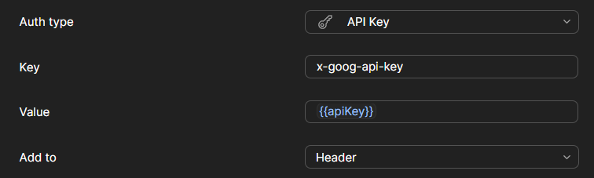
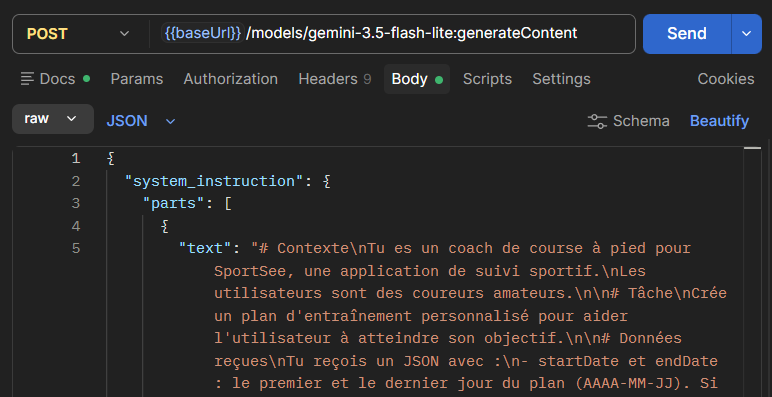
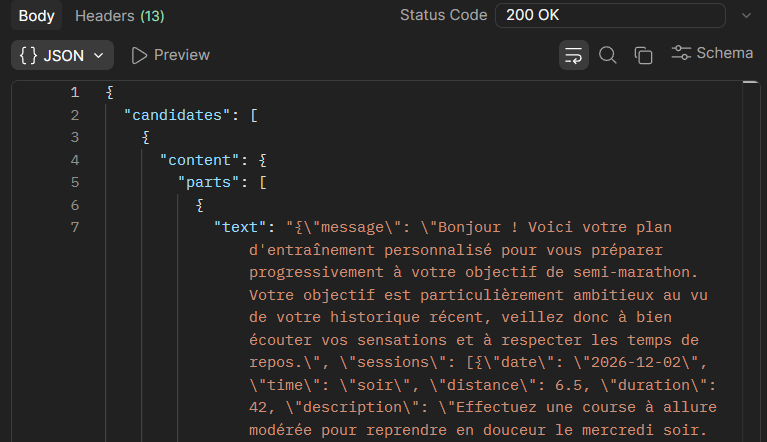
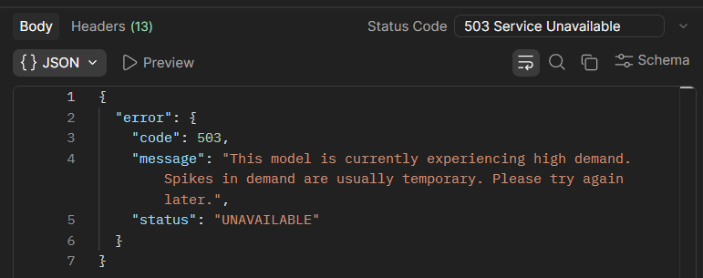
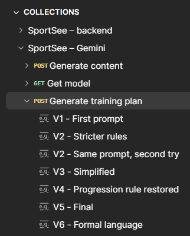
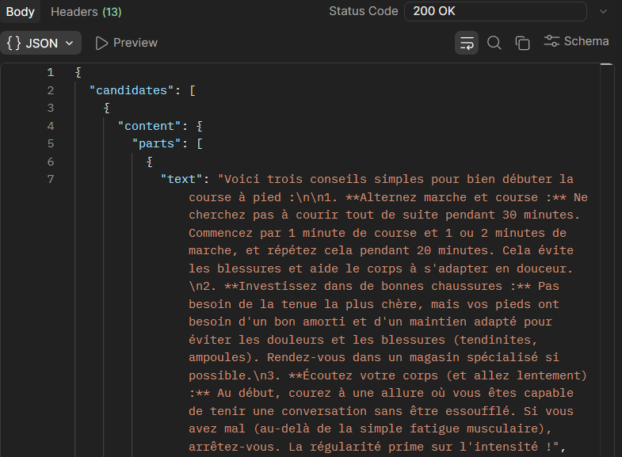
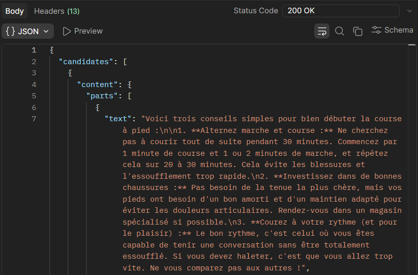
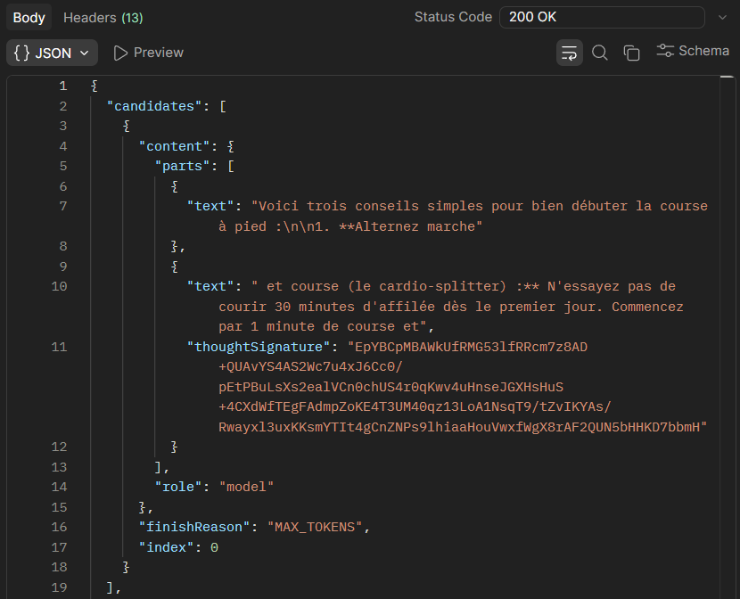

# SportSee – Préparation de l'API d'IA

## Introduction

SportSee veut proposer à ses utilisateurs un plan d'entraînement de course à pied sur 6 semaines, créé par une IA à partir de leurs séances passées et de leur objectif.

Ce document prépare cette fonctionnalité. Il présente l'API utilisée, la requête, les données envoyées et le prompt, puis les limites, les risques et les pistes pour la suite. Tous les tests ont été faits dans Postman, avec des données fictives.

L'API prévue au départ était celle de Mistral. Au moment du projet, obtenir une clé API Mistral demandait un moyen de paiement. On a donc choisi l'API Gemini de Google, qui propose une offre gratuite suffisante pour un prototype.

## 1. En bref

## 2. L'API utilisée

### Le modèle

On utilise le modèle `gemini-3.5-flash-lite`, avec l'API Gemini de Google. C'est un modèle stable, que Google présente comme son modèle 3.5 le plus rapide et le moins cher ([liste des modèles](https://ai.google.dev/gemini-api/docs/models)).


### Les limites

Un token est un morceau de texte d'environ 4 caractères. C'est l'unité qui sert à compter les limites et le prix.

| Limite                    | Valeur                                                                                                                                                     | Ce que ça veut dire                                                                                                                                        |
| ------------------------- | ---------------------------------------------------------------------------------------------------------------------------------------------------------- | ---------------------------------------------------------------------------------------------------------------------------------------------------------- |
| Taille de ce qu'on envoie | Environ 1 million de tokens                                                                                                                                | Largement assez pour les données d'un utilisateur                                                                                                          |
| Longueur de la réponse    | Environ 65 000 tokens                                                                                                                                      | Assez pour un plan de 6 semaines                                                                                                                           |
| Requêtes par minute       | 15                                                                                                                                                         | Au-delà, l'API renvoie l'erreur 429 `RESOURCE_EXHAUSTED` (ressources épuisées)                                                                             |
| Requêtes par jour         | 500, remises à zéro à minuit, heure du Pacifique (9 h en France la plupart de l'année)                                                                     | Au-delà, l'API renvoie l'erreur 429 `RESOURCE_EXHAUSTED` (ressources épuisées)                                                                             |
| Coût                      | Gratuit avec l'offre gratuite. Avec l'offre payante : 0,30 dollar par million de tokens envoyés et 2,50 dollars par million de tokens reçus                | Un plan (environ 900 tokens envoyés et 900 reçus) coûterait environ 0,25 centime de dollar                                                                 |
| Disponibilité             | L'IA est souvent surchargée : erreur 503 `UNAVAILABLE` (indisponible)                                                                                      | Il faut parfois attendre plus d'une minute avant de réessayer                                                                                              |
| Confidentialité           | Avec l'offre gratuite, Google peut utiliser ce qu'on lui envoie pour améliorer ses produits, sauf en Europe, où les règles de l'offre payante s'appliquent | Google demande de ne jamais envoyer d'informations sensibles, confidentielles ou personnelles avec l'offre gratuite : on n'envoie que des données fictives |

Sources : [quotas](https://ai.google.dev/gemini-api/docs/rate-limits), [prix](https://ai.google.dev/gemini-api/docs/pricing), [conditions d'utilisation](https://ai.google.dev/gemini-api/terms).

### Les conditions d'utilisation

Les conditions de Google posent trois règles importantes pour SportSee :

- pour proposer la fonctionnalité au public en Europe, l'offre payante est obligatoire ;
- l'API ne doit pas servir à donner des avis médicaux ;
- l'API ne doit pas être utilisée dans une application destinée aux moins de 18 ans, ou que des mineurs peuvent utiliser.

### La clé API

La clé est rangée dans l'environnement Postman « Gemini », dans la variable `apiKey`. Elle reste sur l'ordinateur : elle n'est jamais partagée ni exportée.


Elle est envoyée automatiquement avec chaque requête, dans le header `x-goog-api-key`. Ce réglage est fait une seule fois, sur la collection.



## 3. La requête

### L'adresse

| Élément | Valeur                                                                                          |
| ------- | ----------------------------------------------------------------------------------------------- |
| Méthode | `POST`                                                                                          |
| URL     | `https://generativelanguage.googleapis.com/v1beta/models/gemini-3.5-flash-lite:generateContent` |

Dans Postman, le début de l'adresse est rangé dans la variable `baseUrl` de l'environnement.

### Les headers

| Header           | Valeur             | Rôle                                                        |
| ---------------- | ------------------ | ----------------------------------------------------------- |
| `x-goog-api-key` | La clé API         | Identifie le projet (voir la partie 2)                      |
| `Content-Type`   | `application/json` | Indique que le body est du JSON. Postman l'ajoute tout seul |

### Le body

Le body contient trois parties :

- `system_instruction` : les consignes données à l'IA, identiques pour tous les utilisateurs (voir la partie 5) ;
- `contents` : les données de l'utilisateur (voir la partie 4) ;
- `generationConfig` : la forme attendue de la réponse, décrite par un schéma (voir la partie 5).

```json
{
  "system_instruction": { "parts": [{ "text": "Les consignes" }] },
  "contents": [
    { "parts": [{ "text": "Les données de l'utilisateur, en JSON" }] }
  ],
  "generationConfig": {
    "responseFormat": {
      "text": { "mimeType": "APPLICATION_JSON", "schema": {} }
    }
  }
}
```



### La réponse

Les informations utiles de la réponse :

- `candidates[0].content.parts[0].text` : le plan. C'est du JSON écrit sous forme de texte : l'application doit le convertir (avec `JSON.parse`) pour s'en servir. Dans nos tests, le plan est toujours arrivé en un seul morceau, mais l'API peut découper un texte en plusieurs morceaux (`parts`), qu'il faut alors mettre bout à bout.
- `finishReason` : `STOP` veut dire que la réponse est complète. `MAX_TOKENS` veut dire qu'elle a été coupée : le JSON serait alors incomplet et inutilisable.
- `usageMetadata` : le nombre de tokens envoyés (`promptTokenCount`) et reçus (`candidatesTokenCount`). C'est ce qui sert à calculer le coût.
- `thoughtSignature` : une version chiffrée, donc illisible, de la réflexion du modèle. Elle sert seulement dans une conversation en plusieurs échanges, pour que l'IA garde le fil. Notre requête ne fait qu'un échange : l'application peut l'ignorer.



### Les erreurs

| Erreur                                         | Cause                                                                      | Que faire                                                        |
| ---------------------------------------------- | -------------------------------------------------------------------------- | ---------------------------------------------------------------- |
| 400 `INVALID_ARGUMENT` (argument invalide)     | Clé invalide, ou body mal écrit                                            | Corriger la clé ou le body. Inutile de réessayer                 |
| 403 `PERMISSION_DENIED` (permission refusée)   | Le projet n'a pas accès à l'API (vérification, facturation, clé divulguée) | Régler le compte ou créer une nouvelle clé. Inutile de réessayer |
| 429 `RESOURCE_EXHAUSTED` (ressources épuisées) | Trop de requêtes (quotas dépassés, voir la partie 2)                       | Réessayer plus tard                                              |
| 503 `UNAVAILABLE` (indisponible)               | L'IA est surchargée                                                        | Réessayer plus tard                                              |
| 500 et autres erreurs 5xx                      | Problème passager chez Google                                              | Réessayer plus tard                                              |

« Réessayer plus tard », c'est attendre de plus en plus longtemps entre deux essais (1 seconde, puis 2, puis 4…), avec un nombre maximum d'essais ([guide des erreurs](https://ai.google.dev/gemini-api/docs/troubleshooting)).

Les erreurs 400 et 503 ont été testées dans Postman :




### Limiter les requêtes

Chaque plan a un coût avec l'offre payante, et les quotas limitent le nombre de requêtes (voir la partie 2). Pour l'intégration dans l'application, on recommande de :

- désactiver le bouton pendant que l'IA prépare le plan, pour éviter les doubles clics ;
- enregistrer le plan reçu, pour que l'utilisateur le retrouve sans relancer l'IA ;
- limiter le nombre de nouveaux plans par utilisateur, par exemple un par jour ;
- limiter le nombre d'essais quand l'API renvoie une erreur 429 ou 503.

## 4. Les données envoyées

### Ce qu'on envoie

| Donnée                                   | Contenu                                                                                      | D'où elle vient                                        |
| ---------------------------------------- | -------------------------------------------------------------------------------------------- | ------------------------------------------------------ |
| `startDate`                              | Le premier jour du plan                                                                      | Choisie par l'utilisateur                              |
| `endDate`                                | Le dernier jour du plan, et le jour de la course si l'objectif est une course                | Calculée par l'application (6 semaines après le début) |
| `goal`                                   | L'objectif (reprendre, rester en forme, 5 km, 10 km, semi-marathon, marathon)                | Choisi dans une liste                                  |
| `availability`                           | Les jours, les moments (matin, midi, après-midi, soir) et la durée maximale de chaque séance | Choisis dans des listes                                |
| `age`                                    | L'âge                                                                                        | Profil SportSee                                        |
| `sessions`                               | Les séances des 8 dernières semaines : date, distance (km), durée (minutes)                  | Séances SportSee                                       |
| `speed`                                  | La vitesse moyenne de chaque séance (km/h)                                                   | Calculée par l'application                             |
| `longestDistance` et `maxWeeklyDistance` | La plus longue séance et la semaine la plus chargée de ces 8 semaines (km)                   | Calculées par l'application                            |

Quelques choix :

- **Les données gardent les noms de champs de l'API SportSee.** L'application n'a qu'à les trier et à ajouter quelques valeurs, sans les transformer.
- **Certaines valeurs sont calculées par l'application** (date de fin, vitesse, plus longue séance, semaine la plus chargée), parce que l'IA se trompe parfois dans les calculs.
- **8 semaines de séances** suffisent pour montrer le niveau actuel. Plus loin dans le passé, le niveau n'est plus le même, et on enverrait des données inutiles.
- **L'utilisateur choisit dans des listes, sans texte libre.** Avec un texte libre, il pourrait écrire une information sensible ou une phrase qui détourne l'IA de sa tâche.

### Ce qu'on n'envoie pas, et pourquoi

| Donnée                                                           | Pourquoi on ne l'envoie pas                                                                                                                                                                                                                                                                            |
| ---------------------------------------------------------------- | ------------------------------------------------------------------------------------------------------------------------------------------------------------------------------------------------------------------------------------------------------------------------------------------------------ |
| Prénom, nom, photo, date d'inscription                           | Ces données permettent de savoir qui est la personne, et ne servent pas à créer le plan                                                                                                                                                                                                                |
| Poids, taille, fréquence cardiaque                               | La CNIL les cite comme des données liées à la santé ([exemple pour les sportifs](https://cnil.fr/fr/la-collecte-de-donnees-pour-la-mesure-de-la-performance-physique-individuelle-des-sportifs-de-haut), [définition d'une donnée de santé](https://www.cnil.fr/fr/quest-ce-ce-quune-donnee-de-sante)) |
| Calories                                                         | Elles sont calculées à partir du poids                                                                                                                                                                                                                                                                 |
| Statistiques globales (distance totale, nombre total de séances) | C'est le niveau actuel qui compte pour le plan, pas le total depuis l'inscription                                                                                                                                                                                                                      |

### Exemple

Les données envoyées pour les tests (fictives) :

```json
{
  "startDate": "2026-11-30",
  "endDate": "2027-01-10",
  "goal": "Semi-marathon",
  "availability": [
    { "day": "mercredi", "time": "soir", "maxDuration": 45 },
    { "day": "dimanche", "time": "matin", "maxDuration": 90 }
  ],
  "age": 32,
  "sessions": [
    { "date": "2026-10-05", "distance": 9.2, "duration": 60, "speed": 9.2 },
    { "date": "2026-10-12", "distance": 5.8, "duration": 38, "speed": 9.2 },
    { "date": "2026-10-19", "distance": 4.4, "duration": 29, "speed": 9.1 },
    { "date": "2026-10-23", "distance": 6.5, "duration": 42, "speed": 9.3 },
    { "date": "2026-10-26", "distance": 5.3, "duration": 35, "speed": 9.1 },
    { "date": "2026-11-02", "distance": 7, "duration": 45, "speed": 9.3 },
    { "date": "2026-11-09", "distance": 5.5, "duration": 36, "speed": 9.2 },
    { "date": "2026-11-16", "distance": 4.2, "duration": 28, "speed": 9.0 }
  ],
  "longestDistance": 9.2,
  "maxWeeklyDistance": 10.9
}
```

Dans la requête, ces données sont envoyées sous forme de texte, dans `contents` (voir la partie 3).

## 5. Le prompt

### Sa structure

Le prompt est découpé en parties, comme le demande la mission :

| Partie            | Où elle se trouve                                                     | Rôle                                                                    |
| ----------------- | --------------------------------------------------------------------- | ----------------------------------------------------------------------- |
| Contexte          | `system_instruction`                                                  | Qui est l'IA, et pour qui elle travaille                                |
| Tâche             | `system_instruction`                                                  | Ce qu'on attend d'elle                                                  |
| Données           | `system_instruction` (leur description) et `contents` (leurs valeurs) | Ce qu'elle reçoit, et comment le lire                                   |
| Règles            | `system_instruction`                                                  | Ce qu'elle doit respecter : disponibilités, sécurité, alimentation, ton |
| Format de réponse | `system_instruction` et le schéma de `generationConfig`               | La forme exacte de la réponse                                           |

Les consignes, identiques pour tous les utilisateurs, sont séparées des données de chacun. Elles parlent à l'IA en « tu », et l'IA vouvoie l'utilisateur, comme le reste de l'application.

### Le prompt final (version 5)

```text
# Contexte
Tu es un coach de course à pied pour SportSee, une application de suivi sportif.
Les utilisateurs sont des coureurs amateurs.

# Tâche
Crée un plan d'entraînement personnalisé pour aider l'utilisateur à atteindre son objectif.

# Données reçues
Tu reçois un JSON avec :
- startDate et endDate : le premier et le dernier jour du plan (AAAA-MM-JJ). Si l'objectif est une course, elle a lieu le jour de endDate.
- goal : l'objectif de l'utilisateur.
- availability : les jours (day) et moments (time) où il peut courir, avec la durée maximale en minutes (maxDuration).
- age : son âge.
- sessions : ses séances des 8 dernières semaines, avec la date, la distance (km), la durée (minutes) et la vitesse moyenne (km/h). Si la liste est vide, considère que c'est un débutant.
- longestDistance et maxWeeklyDistance : sa plus longue séance et sa semaine la plus chargée de ces 8 semaines (km).

# Règles
- Place les séances uniquement aux jours et moments de availability, entre startDate et endDate.
- Ne dépasse jamais maxDuration, sauf pour la course elle-même.
- La sécurité passe avant l'objectif.
- Au début, pas de séance plus longue que longestDistance ni de semaine plus chargée que maxWeeklyDistance. Ensuite, augmente petit à petit.
- Garde une vitesse proche de celle de ses séances passées. Tu peux l'augmenter légèrement, petit à petit.
- Si l'objectif n'est pas atteignable sans risque, dis-le clairement dans message.
- Ne promets aucun résultat ni aucune sécurité, et n'invente aucune information absente des données.
- Donne seulement des conseils alimentaires généraux : pas de régime, pas de compléments alimentaires. Rappelle de les adapter à ses allergies et à ses habitudes alimentaires.
- Ne donne aucun avis médical.
- Vouvoie toujours l'utilisateur. Écris en français correct, avec des mots simples et un ton encourageant.

# Format de réponse
Réponds uniquement en JSON, selon le schéma fourni.
```

### La forme de la réponse

Le schéma envoyé dans `generationConfig` impose cette forme :

| Champ           | Contenu                                                                                                                                                                                           |
| --------------- | ------------------------------------------------------------------------------------------------------------------------------------------------------------------------------------------------- |
| `message`       | Une présentation du plan en 2 à 4 phrases, avec un avertissement si l'objectif est ambitieux                                                                                                      |
| `sessions`      | La liste des séances, dans l'ordre des dates. Pour chacune : `date`, `time` (matin, midi, après-midi ou soir), `distance` (km), `duration` (minutes) et `description` (comment aborder la séance) |
| `nutritionTips` | 3 à 5 conseils alimentaires généraux                                                                                                                                                              |

Le schéma complet se trouve dans la collection Postman (requête Generate training plan).

### Exemple de réponse

Réponse obtenue avec la version 5. La vitesse n'est pas fournie par l'IA : elle est calculée à partir de la distance et de la durée reçues dans la réponse.

> Bonjour ! Voici votre plan d'entraînement personnalisé pour vous préparer progressivement à votre objectif de semi-marathon. Votre objectif est particulièrement ambitieux au vu de votre historique récent, veillez donc à bien écouter vos sensations et à respecter les temps de repos.

| Date          | Moment | Distance | Durée   | Vitesse  | Description                                                                                          |
| ------------- | ------ | -------- | ------- | -------- | ---------------------------------------------------------------------------------------------------- |
| Mer. 2 déc.   | soir   | 6,5 km   | 42 min  | 9,3 km/h | Effectuez une course à allure modérée pour reprendre en douceur le mercredi soir.                    |
| Dim. 6 déc.   | matin  | 9 km     | 60 min  | 9,0 km/h | Partez pour une sortie longue dominicale en gardant une allure confortable et régulière.             |
| Mer. 9 déc.   | soir   | 6,5 km   | 42 min  | 9,3 km/h | Maintenez une vitesse constante tout au long de votre séance du mercredi.                            |
| Dim. 13 déc.  | matin  | 10 km    | 65 min  | 9,2 km/h | Augmentez légèrement votre distance ce dimanche en restant à l'écoute de votre corps.                |
| Mer. 16 déc.  | soir   | 6,8 km   | 44 min  | 9,3 km/h | Réalisez cette séance de milieu de semaine avec un effort stable et mesuré.                          |
| Dim. 20 déc.  | matin  | 11,5 km  | 75 min  | 9,2 km/h | Profitez de votre matinée de dimanche pour une sortie longue un peu plus soutenue.                   |
| Mer. 23 déc.  | soir   | 6,8 km   | 44 min  | 9,3 km/h | Courrez à votre rythme habituel pour garder de bonnes sensations.                                    |
| Dim. 27 déc.  | matin  | 13 km    | 85 min  | 9,2 km/h | Consacrez votre dimanche matin à une sortie longue pour préparer l'endurance nécessaire.             |
| Mer. 30 déc.  | soir   | 7 km     | 45 min  | 9,3 km/h | Restez sur une allure aisée lors de ce dernier mercredi de l'année.                                  |
| Dim. 3 janv.  | matin  | 14 km    | 90 min  | 9,3 km/h | Effectuez votre dernière sortie longue significative en prenant soin de bien vous hydrater.          |
| Mer. 6 janv.  | soir   | 5 km     | 33 min  | 9,1 km/h | Faites une courte course de décrassage pour garder le corps actif avant la fin de semaine.           |
| Dim. 10 janv. | matin  | 21,1 km  | 140 min | 9,0 km/h | Jour de course pour votre semi-marathon, gérez votre effort du mieux possible du départ à l'arrivée. |

Conseils alimentaires :

- Pensez à adapter vos repas à vos habitudes alimentaires et à vos éventuelles allergies.
- Veillez à vous hydrater régulièrement tout au long de la journée, sans attendre d'avoir soif.
- Privilégiez des repas équilibrés contenant des glucides pour faire le plein d'énergie avant vos sorties.
- Évitez les aliments trop gras ou trop lourds juste avant de courir pour faciliter votre digestion.

Les textes sont recopiés tels quels, erreurs comprises s'il y en a : elles sont expliquées dans les versions testées et dans la partie 7.

### Les versions testées

Six versions du prompt ont été testées, toujours avec les mêmes données. Chaque réponse est enregistrée comme exemple dans la collection Postman.



| Version     | Ce qui a changé                                                                        | Ce qu'on a constaté                                                                                                           |
| ----------- | -------------------------------------------------------------------------------------- | ----------------------------------------------------------------------------------------------------------------------------- |
| V1          | Premier prompt, avec des types de séance et un exemple de séance                       | Tutoiement, départ trop brusque, vitesse incohérente, promesse (« en toute sécurité »), information inventée, mots techniques |
| V2          | Règles plus précises : départ, vitesse, promesses, vouvoiement, mots simples           | Vouvoiement et vitesses corrigés. Envoyée deux fois : sans accents, puis avec. La forme varie d'une réponse à l'autre         |
| V3          | Simplifiée : sans types de séance ni règles de coach. L'application fournit la vitesse | Meilleur français, objectif ambitieux signalé. Mais le départ est de nouveau trop brusque                                     |
| V4          | Retour de la règle de départ précise                                                   | L'IA calcule mal la plus longue séance et la semaine la plus chargée, et recopie l'exemple                                    |
| V5 (finale) | L'application fournit ces deux valeurs. Plus de promesse de sécurité, plus d'exemple   | Plus longue séance respectée, plus de promesse ni de copie. La semaine la plus chargée est encore dépassée                    |
| V6          | Sans limite par semaine, français soigné, conseils de course                           | Pas de progrès, et l'IA recopie les consignes dans sa réponse                                                                 |

Ce que ces tests montrent :

- les règles simples (jours, durées, vouvoiement, vitesse) sont bien suivies ;
- les règles qui demandent un calcul ne sont pas fiables, même quand on fournit les valeurs de référence ;
- la même requête ne donne pas toujours la même réponse ;
- l'IA a tendance à recopier ce qu'on lui écrit : l'exemple, puis les consignes.

## 6. Les réglages testés

Ces réglages ont été testés avec une question simple (« Donne trois conseils simples pour bien débuter la course à pied. »), dans la requête Generate content de la collection Postman.

| Réglage                       | Ce qu'il est censé faire                                                                    | Ce qu'on a constaté                                                                                                                                                                                                                                                                                     |
| ----------------------------- | ------------------------------------------------------------------------------------------- | ------------------------------------------------------------------------------------------------------------------------------------------------------------------------------------------------------------------------------------------------------------------------------------------------------- |
| Température (0 et 2)          | Régler la part de hasard : à 0, la réponse devrait toujours être la même ; à 2, plus variée | À 0, deux envois donnent des réponses très proches, mais pas identiques : Google indique qu'une petite variation reste possible ([réglage des paramètres](https://cloud.google.com/vertex-ai/generative-ai/docs/learn/prompts/adjust-parameter-values)). À 2, la réponse reste très proche de celle à 0 |
| Top P (0,1)                   | Limiter l'IA aux mots les plus probables, pour une réponse plus prévisible                  | La réponse reste très proche de celle à température 0                                                                                                                                                                                                                                                   |
| Longueur maximale (50 tokens) | Limiter la longueur de la réponse                                                           | La réponse est coupée net, et l'API l'indique (`MAX_TOKENS`). La limite n'est pas exacte : entre 48 et 60 tokens                                                                                                                                                                                        |

Par défaut, le modèle utilise une température de 1 et un top P de 0,95 (voir la fiche du modèle, partie 2).







### Ce qu'on a retenu pour la requête finale

- **Température et top P : non utilisés.** Pour ce modèle, Google conseille de garder les valeurs par défaut ([guide de génération de texte](https://ai.google.dev/gemini-api/docs/text-generation)), et nos tests n'ont montré aucun effet. Le ton et la forme de la réponse se règlent dans le prompt.
- **Longueur maximale : non utilisée.** Une réponse coupée donnerait un JSON incomplet, donc inutilisable.
- **Niveau de réflexion (`thinkingLevel`) : valeur par défaut**, la plus basse. Le tester plus haut est une piste (voir la partie 8).

## 7. Limites, risques et éthique

## 8. Pour la suite
